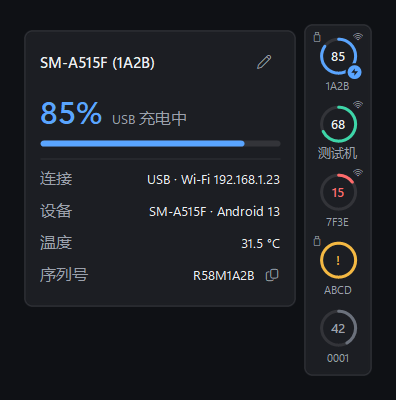

# ADB Monitor

常驻桌面的小窗，一眼看清通过 ADB 连到本机的 Android 设备：有线（USB 调试）/ 无线（无线调试）连接状态和电量。



## 下载与运行

运行环境：

- Windows 11 x64（旧系统上窗口是直角，未专门测试）
- [.NET 10 桌面运行时](https://dotnet.microsoft.com/download/dotnet/10.0)
- `adb.exe`：在 `PATH` 中，或位于 `%LOCALAPPDATA%\Android\Sdk\platform-tools`（Android Studio 的默认安装位置）

从 [Releases](https://github.com/leoskey/adb-monitor/releases/latest) 下载 `AdbMonitor.exe`，直接运行。小窗出现在屏幕右侧，不占任务栏；右键小窗可以设置开机自启或退出。

> [!WARNING]
> 程序会自动连接局域网里开着无线调试的设备。在公司、学校这类共享网络里，同网段其他人开着 5555 端口调试的设备也会被连接，对方设备上可能弹出「允许 USB 调试」。

## 使用

### 图标

每台设备一个圆环，环的长度是电量，中间是百分比，下方是名称（默认是序列号后 4 位）。

| 颜色 | 含义 |
| --- | --- |
| 青绿 | 正常 |
| 蓝色，右下角有闪电 | 充电中 |
| 珊瑚红 | 电量低于 20% |
| 琥珀色整环和 `!` | 未授权或离线，需要在设备上处理 |
| 灰色 | 已断开，保留最后一次的电量 |

左上角的角标表示 USB 连接，右上角表示 Wi-Fi 连接；同一台设备同时有线和无线连接时合并成一个图标，两个角标都显示。

### 操作

- **单击图标**：打开详情卡片，显示电量与充电状态、连接方式（无线带 IP）、型号与系统版本、温度、序列号。点另一台设备立即切换；再点同一台或点屏幕其他地方关闭。
- **改名**：点卡片标题右侧的铅笔，回车或点对勾保存，Esc 取消；清空或不改动默认名称则恢复默认。
- **复制序列号**：点序列号右侧的按钮。
- **移除设备**：已断开的设备在卡片底部有「移除设备」。在线设备不能移除。
- **右键图标**：重命名、移除、开机自启、退出。
- **拖动**：按住小窗移动；靠近屏幕边缘会自动贴边。贴左右边时竖排，贴上下边时横排。

### 无线设备

- **Android 11 及以上的无线调试**：首次配对需要手动完成（`adb pair`，或 Android Studio 扫码配对）；配对过的设备之后在局域网内会被自动发现并连接。
- **旧式无线调试**（固定 5555 端口，例如 PICO）：自动探测本机所在网段并连接。没授权过本机的设备会弹出「允许 USB 调试」。

## 限制

- 模拟器（`emulator-*`）会被忽略。
- 界面只有深色。
- 开机自启记录的是 exe 的当前路径，移动 exe 后需要在右键菜单里重新勾选。

## 数据

- 状态文件：`%APPDATA%\AdbMonitor\state.json`（窗口位置、贴边方向、已知设备及其别名和最后电量）。
- 开机自启：`HKCU\Software\Microsoft\Windows\CurrentVersion\Run` 下的 `AdbMonitor` 值。

## 开发

需要 .NET 10 SDK。

```bash
dotnet build
```

```bash
dotnet publish -c Release -o publish
```

产物：`publish/AdbMonitor.exe`（依赖框架的单文件 exe）。

### 验证

```bash
dotnet run -- --selftest
```

运行解析、卡片内容与贴边逻辑的自检，退出码 0 表示通过。附加 png 路径（`--selftest out.png`）会额外把演示数据渲染成图片，并对卡片执行改名、移除的点击测试：`out.png` 是小窗，`out.card0.png` ~ `out.card4.png` 是五台演示设备的卡片，`out.rename.png` 是改名状态。

```bash
dotnet run -- --scan
```

只执行一次局域网 ADB 探测，输出找到的 IP（用于排查无线设备为什么没被发现）。

```bash
dotnet run -- --demo
```

用假数据（充电、正常且带别名、低电量、未授权、已断开各一台）运行界面并展开一张卡片，不读写状态文件，可以和正式实例同时运行。

`docs/screenshot.png` 由 `--selftest` 渲染出的小窗（`out.png`）和第一张卡片（`out.card0.png`）拼成，界面变化后需要重新生成。

### 实现说明

- **轮询**：每 5 秒执行一次 `adb devices -l`，并对在线设备查询型号、系统版本和 `dumpsys battery`。
- **合并**：同一台设备的有线和无线连接按 `ro.serialno` 合并。
- **mDNS 发现**：通过 `adb mdns services` 找到已广播无线调试、但还没连上的设备，自动 `adb connect`（未配对的会直接失败）。
- **5555 端口探测**：每 30 秒探测本机所在私有网段（有网关、前缀 22~30 位的网卡）的 5555 端口，发送 ADB `CNXN` 握手包，只连接真正回 ADB 协议的主机。探测本身不发送公钥，不会在设备上弹出授权框；弹框来自随后的 `adb connect`。
- **窗口**：无边框、置顶、不抢焦点；Win11 下使用系统圆角、描边与阴影。拖到贴靠线 20px 内自动贴边，贴边后与屏幕边缘保持 12px 间距。详情卡片朝屏幕内侧展开，随轮询刷新；平时不取得焦点，只有改名时主动激活以便输入。

## 许可证

[MIT](LICENSE)
